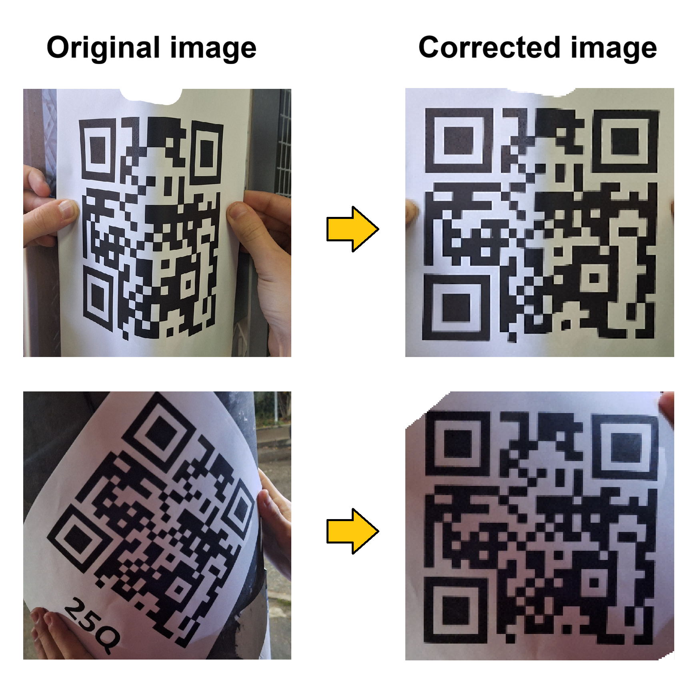

# CSQR-D — декодирование QR-кодов на криволинейных поверхностях

[English version](README.md)

Обнаружение и декодирование QR-кодов, размещённых на произвольных гладких неплоских поверхностях. Реализация на C++ также поддерживает Data Matrix.

CSQR-D восстанавливает геометрию искривлённого матричного кода, выпрямляет изображение и затем использует обычный декодер для извлечения данных.

На текущем наборе QR-кодов для бенчмарка реализация CSQR-D на C++ декодирует **166 из 169 изображений (98,22%)**. Подробные результаты и условия измерений приведены ниже.

## Что такое CSQR-D?

Большинство QR-декодеров рассчитано на изображения, в которых QR-код можно приблизительно описать плоским проективным преобразованием. Когда QR-код напечатан на искривлённой поверхности, например на цилиндре или другом гладком неплоском объекте, это предположение перестаёт работать: разные части кода могут искажаться по-разному.

CSQR-D предназначен специально для такого типа геометрической деформации. Вместо того чтобы пытаться заставить обычный декодер обработать искажённое изображение напрямую, он сначала восстанавливает геометрию QR-кода и строит приблизительно регулярное представление, которое может быть декодировано обычными QR-считывателями.

Текущая реализация предназначена для QR-кодов и Data Matrix на **гладких искривлённых поверхностях**. Она не рассчитана в первую очередь на произвольные физические повреждения, разрывы или сильно негладкие деформации.

## Приложение

CSQR-D интегрирован в **Curved QR Scanner** — Android-приложение для практического сканирования QR-кодов. Приложение предоставляет удобный интерфейс с использованием камеры, а сканер CSQR-D помогает обрабатывать QR-коды, которые обычным сканерам трудно прочитать.

[Скачать Curved QR Scanner из GitHub Releases](https://github.com/Akula538/CSQR-D/releases)

## Бенчмарк

### Набор данных

Для бенчмарка используются **169 снимков** QR-кодов на искривлённых поверхностях, сделанных на смартфон, из `data/qr/data1`. Изображения разделены на четыре уровня деформации:

- **0** — почти плоская поверхность (12 образцов)
- **1** — небольшая кривизна (53 образца)
- **2** — заметная кривизна (92 образца)
- **3** — сильная кривизна (12 образцов)

Все сканеры получают одинаковые изображения, уменьшенные перед тестированием без дополнительной внешней предобработки.

### Точность распознавания

Точность — это доля успешно декодированных изображений для каждого уровня деформации. Общий результат рассчитан по всему набору из 169 снимков.

| Деформация | Образцы | ZXing-C++ | ZBar / pyzbar | OpenCV | QReader | CSQR-D |
|---|---:|---:|---:|---:|---:|---:|
| 0 | 12 | 58,33% | 50,00% | 33,33% | 66,67% | 100,00% |
| 1 | 53 | 37,74% | 16,98% | 13,21% | 33,96% | 100,00% |
| 2 | 92 | 9,78% | 6,52% | 0,00% | 6,52% | 96,74% |
| 3 | 12 | 0,00% | 0,00% | 0,00% | 0,00% | 100,00% |
| **Всего** | 169 | 21,30% | 12,43% | 6,51% | 18,93% | 98,22% |

Дополнительные реальные наборы в исходном разрешении: **14/20** в `data/qr/data3` (складки, точное совпадение строк) и **41/68** в `data/qr/data4`.

### Сравнение времени работы

Время работы измеряется на **135 изображениях** из более простого набора `data/qr/data2`. Каждое изображение сканируется трижды; в таблице приведены среднее время, медиана и P95. P95 — время, за которое завершаются 95% вызовов.

| Сканер | Среднее (мс) | Медиана (мс) | P95 (мс) |
|---|---:|---:|---:|
| ZXing-C++ | 8,27 | 8,33 | 9,81 |
| ZBar / pyzbar | 14,81 | 14,97 | 17,62 |
| OpenCV | 27,24 | 28,62 | 39,18 |
| QReader | 248,83 | 183,06 | 718,41 |
| CSQR-D | 27,54 | 22,49 | 56,06 |

### Время работы CSQR-D

Этот тест оценивает время работы CSQR-D на наборе искривлённых QR-кодов. В таблице приведено среднее время обработки в миллисекундах, по степени деформации и уровню коррекции ошибок QR (L, M, Q, H). Изображения уменьшаются перед сканированием; время уменьшения не учитывается.

| Деформация / EC | L | M | Q | H |
|---|---:|---:|---:|---:|
| 0 | 32,59 | 23,80 | 26,42 | 24,92 |
| 1 | 29,85 | 26,17 | 26,52 | 26,54 |
| 2 | 32,80 | 34,49 | 26,85 | 31,78 |
| 3 | 57,63 | 36,04 | 27,41 | 29,00 |

Во всех тестах используется реализация CSQR-D на C++. [Подробная методика, условия измерений и воспроизведение](docs/BENCHMARKS.ru.md).

### Data Matrix

Результаты C++-сканера на 114 фотографиях искривлённых Data Matrix из `data/datamatrix/data1` в исходном разрешении. Время включает предобработку, исключает чтение файлов и рассчитано по медианам трёх запусков на изображение с одним потоком OpenCV.

| Сканер / режим | Декодировано | Среднее (мс) | Медиана (мс) | P95 (мс) |
|---|---:|---:|---:|---:|
| ZXing-C++ | 10/114 | 23,4 | 18,9 | 31,0 |
| CSQR-D, обычный | 98/114 | 116,2 | 65,3 | 339,0 |
| CSQR-D, расширенный | 102/114 | 213,5 | 69,0 | 1040,6 |

## Как это работает

CSQR-D организован как многоэтапный конвейер восстановления. Сначала он пытается выполнить обычное декодирование матричного кода и запускает более затратную геометрическую реконструкцию только при необходимости.

### 1. Начальное декодирование

Входное изображение сначала передаётся обычному декодеру соответствующего формата. Если код уже читается, геометрическая реконструкция не требуется.

### 2. Обнаружение поисковых шаблонов

Когда стандартное декодирование не удаётся, CSQR-D ищет три поисковых шаблона QR-кода. Для Data Matrix опорой служат сплошная L-рамка и две тактовые стороны.

Детектор на основе контуров использует структуру вложенных контуров вместе с геометрическими ограничениями для выявления кандидатов в поисковые шаблоны и определения конфигурации трёх шаблонов. Это даёт геометрическую опору, необходимую для следующих этапов реконструкции.

### 3. Реконструкция геометрии QR-кода

Обнаруженные поисковые шаблоны используются для восстановления положения и ориентации сетки QR-кода. Для плоского QR-кода обычно достаточно перспективного преобразования. Однако на искривлённой поверхности деформация различается по всему коду, поэтому одного плоского преобразования недостаточно.

Поэтому CSQR-D восстанавливает дополнительную информацию о сетке QR-кода, включая распределение её внутренней структуры и, при наличии, шаблоны выравнивания.

### 4. Восстановление локальной деформации

Для сильно искривлённых или иным образом сложных образцов CSQR-D оценивает локальную деформацию изображения кода по градиентам изображения.

Сначала производные Собеля используются для получения локальных направлений градиента. Затем изображение рассматривается в локальных областях, где доминирующие направления градиента оцениваются по пикам локального распределения ориентаций. Эти направления образуют векторное поле, описывающее локальную структуру искажённого изображения кода.

Через это векторное поле проводятся интегральные кривые. Их пересечения формируют восстановленную сетку точек, соответствующих регулярной структуре матричного кода. Затем к этим точкам подбирается преобразование **Thin Plate Spline (TPS)**, которое используется для выпрямления изображения.

### 5. Окончательное декодирование

После геометрической коррекции восстановленное изображение передаётся обычному декодеру QR или Data Matrix. Таким образом, назначение CSQR-D прежде всего — решить **задачу восстановления геометрии**, а стандартный декодер выполняет собственно декодирование символа.

## Ограничения

Сейчас CSQR-D лучше всего работает, когда:

- все три поисковых шаблона хорошо видны;
- модули QR-кода приблизительно квадратные, а не скруглённые;
- центральная часть QR-кода не имеет значительных перекрытий;
- фон не содержит сильных направленных текстур или линейных узоров;
- QR-код снят с достаточным разрешением;
- деформация является гладкой, а не произвольной или разрывной.

Текущая реализация не поддерживает надёжно несколько кодов на одном изображении.

## Набор данных

Набор данных для бенчмарка доступен непосредственно в репозитории:

[**Набор данных CSQR-D**](https://github.com/Akula538/CSQR-D/tree/main/data)

## Использование и интеграция

Репозиторий содержит реализации CSQR-D на Python и C++, поэтому сканер также можно интегрировать в другие проекты. Поддержка Data Matrix доступна в реализации на C++.

- [Реализация на Python](src/python)
- [Реализация на C++](src/cpp)

Android-приложение предоставляется как практическая демонстрация сканера:

[**Релизы Curved QR Scanner**](https://github.com/Akula538/CSQR-D/releases)

## Лицензия

См. [LICENSE](LICENSE).
